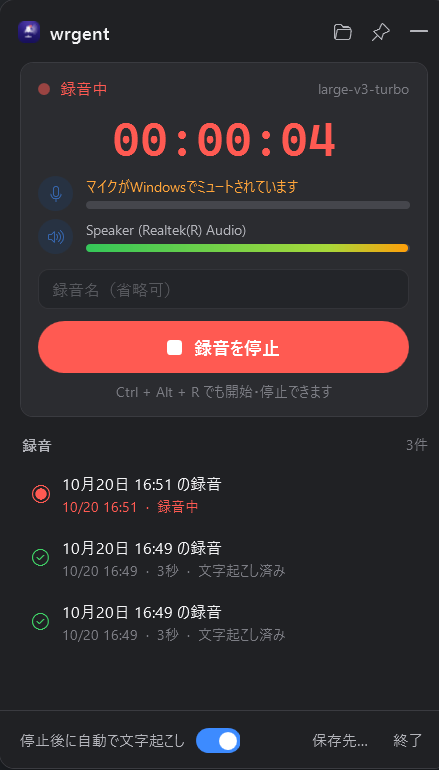

# wrgent for Windows

PCで鳴っている音（Zoom・Teams・ブラウザなど何でも）と自分のマイクを1本の音声にまとめて録音し、ローカルで文字起こしするWindowsアプリです。macOS版にあったZoom自動録音、カレンダー連携、週報生成は入れていません。

## 使い方



1. `wrgent.exe` を起動すると、Mac版のメニューバーと同じようにタスクトレイの上にパネルが開きます。
2. 「録音を開始」を押すか **Ctrl+Alt+R** を押します。マイクとPCの音はそれぞれのボタンでオン/オフできます。
3. もう一度押すと停止し、`mix.m4a` に保存したあと自動で文字起こしします（「停止後に自動で文字起こし」で切り替え）。
4. 一覧の行にマウスを乗せると、文字起こし・テキストを開く・フォルダを開くボタンが出ます。

パネルは他の場所をクリックすると隠れ、トレイアイコンのクリックでまた開きます。ピンのボタンで固定すると普通のウィンドウとして残り、ヘッダーをドラッグして動かせます。録音中はトレイアイコンに赤い点が付きます。終了はパネル右下の「終了」かトレイアイコンの右クリックメニューから行います。画面の色はWindowsのライト/ダーク設定に合わせます。初回起動時に文字起こしモデル（約550MB）を取得します。

## 保存先

```text
%USERPROFILE%\Music\wrgent\            # 「保存先…」で変更可
└── YYYYMMDD_HHMMSS - 会議名\
    ├── mix.m4a                          # マイク＋PC音声（AAC 160kbps, 48kHz stereo）
    └── transcript.txt                   # [hh:mm:ss] 付きの文字起こし
%LOCALAPPDATA%\wrgent\
├── models\                              # whisper / VAD モデル
├── settings.json
└── wrgent_log.txt
```

## 仕組み

- 画面: WPF。
- 録音: WASAPI で既定のマイクと、**有効なすべての再生デバイス**のループバックを同時に取り込み、48kHzに揃えて混ぜます（NAudio）。アプリがどの出力に音を出していても録れます。録音中にヘッドセットの抜き差しやBluetooth機器の接続で再生・録音デバイスが増減したり既定が切り替わったりすると、その場で取り込み先を付け替えて録音を続けます。停止後にWindows標準のAACエンコーダでM4Aにします。
- マイクがWindowsでミュート（または音量0）になっていても、録音中だけミュートを解除して録り、停止時に元に戻します。解除している間はパネルに表示します。`settings.json` の `UnmuteMicWhileRecording` を `false` にするとこの動作を止められます。
- 文字起こし: [whisper.cpp](https://github.com/ggml-org/whisper.cpp) を [Whisper.net](https://github.com/sandrohanea/whisper.net) 経由で使い、**Vulkan でGPUに載せます**。Vulkanが使えない環境では自動でCPUに切り替わります。モデルは large-v3-turbo（q5_0量子化）です。
- 無音や雑音の区間で定型句が出る幻聴を避けるため、Silero VAD で話している区間だけを認識します。

### エンジン選定の理由（開発機: Ryzen 5 230 / Radeon 760M / RAM 15GB）

NVIDIA GPUが無いのでCUDA系（faster-whisper等）は使えません。内蔵GPUのRadeon 760MはVulkanで使えるため、whisper.cppのVulkanバックエンドが最も速くなりました。4分21秒の日本語音声で計測した結果は次のとおりです。

| 構成 | 処理時間 | 速度 |
| --- | --- | --- |
| Vulkan + large-v3-turbo q5_0 | 45秒 | 実時間の約5.9倍 |
| Vulkan + large-v3-turbo q8_0 | 54秒 | 約4.9倍 |
| CPU のみ + large-v3-turbo q5_0 | 270秒 | 約1.0倍 |

q5_0とq8_0の認識結果は同じだったため、速い q5_0 を既定にしています。`settings.json` の `ModelQuantization` を `q8_0` にすると切り替えられます。NPU（Ryzen AI）は whisper の実行環境がまだ限られるため使っていません。

## ビルド

.NET 8 SDK が必要です。

```powershell
cd windows\WrgentWin
dotnet publish -c Release -o ..\dist
```

`windows\dist\wrgent.exe` ができます。.NETランタイムを同梱するので、配布先にインストールは不要です。

動作確認用に、コマンドラインから次のように呼べます。

```powershell
wrgent.exe --record 15 C:\temp\rec        # 15秒録音して mix.m4a を作る
wrgent.exe --transcribe C:\temp\rec\mix.m4a [q5_0|q8_0]
```

環境変数 `WRGENT_RUNTIME=cpu` を付けるとGPUを使わずに文字起こしします。

## 制限

- 話者の区別はしません。
- 録音のためにミュートを解除している間は、Zoomなど他のアプリにもマイクの音が届きます。会議アプリ側のミュートは影響を受けません。
- ノートPCのマイクミュートキーなど、ハードウェア側で切っている場合は録れません。
- 付け替えの間（0.5秒程度）はその入力が無音になります。
